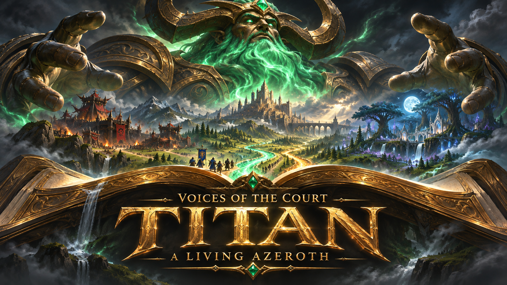
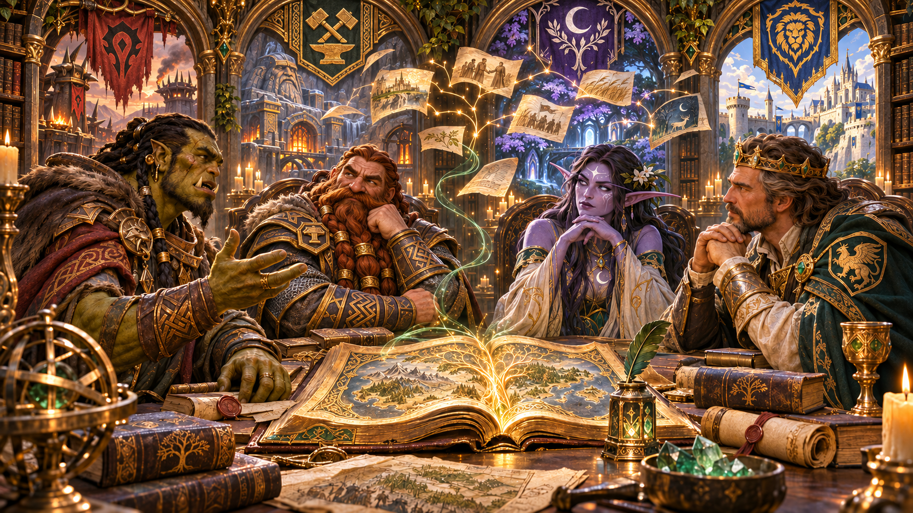

<p align="center">
  
</p>

<h1 align="center">Warcraft roleplay for your CK3 campaign</h1>

<p align="center">
  <strong>Talk to Azeroth's characters with its lore, voices and your campaign's history behind them.</strong><br>
  Titan is MimirLab's GoA2 fork of Voices of the Court Community Edition.<br>
  Play with local AI or connect the provider of your choice.
</p>

<p align="center">
  <a href="https://github.com/MimirLab/VOTC-Titan/releases/tag/titan-preview-2026.11.11.2"></a>
</p>

<p align="center">
  <a href="#the-lorebook-follows-your-campaign">Explore Titan</a> ·
  <a href="docs/getting-started.md">Installation & requirements</a> ·
  <a href="docs/features.md">Feature tour</a> ·
  <a href="CREDITS.md">Credits</a> ·
  <a href="https://github.com/MimirLab/VOTC-Titan/issues">Report a problem</a>
</p>

<p align="center">
  
  <a href="https://github.com/MimirLab/VOTC-Titan/actions/workflows/source-checks.yml"></a>
</p>

| **37,026 lore passages** | **419 character voice banks** | **868 scenes** |
| :---: | :---: | :---: |
| Warcraft lore, expanded material and GoA2 histories built into the launcher | Voices for **407 named characters**, plus individual casting | **855 custom scenes** with **851 paintings** |

> **Linux x64 / X11.** Requires CK3, the GoA2 and VOTC CE Steam addons, and an AI connection. [Requirements, game versions and installation →](docs/getting-started.md)

## The lorebook follows your campaign

Titan's embedded Warcraft lorebook covers the people, places, histories and beliefs of Azeroth. Expanded setting material and **141 GoA2 branch accounts** carry that world into your campaign.

As the game changes, Titan reads the current state and changes which history reaches the roleplay engine. It retrieves the relevant entries for a conversation, then opens deeper details as they are needed. Character knowledge controls access: public history, personal experience and private thoughts are handled separately.

[Read about the evolving lorebook →](docs/features.md#the-embedded-evolving-lorebook)

<p align="center">
  
  <sub>Promotional artwork for Titan.</sub>
</p>

## Character voices and individual casting

**419 voice banks cover 407 named GoA2 characters.** Automatic matching connects encountered characters to their collected recordings. Characters with several forms have separate voice routes: Arthas's living, death knight and Lich King voices follow his current traits in the game.

Individual casting gives other characters a saved voice built from their physical form, cultural pronunciation, maturity and personal voice design. You can preview voices, assign your own references and keep those choices across later conversations.

Dialogue, whispered thoughts and narration have separate delivery. Titan prepares later passages during playback and keeps them in story order, with pause, resume and stop controls.

[Voice system →](docs/features.md#voices-with-continuity) · [Set up Breeze →](docs/getting-started.md#optional-character-audio)

## Culture, faith and language

A character's upbringing and beliefs affect how they speak and what matters to them. Titan supplies current culture and faith backgrounds, **166 cultural speech profiles**, and **35 devotional profiles covering 42 faiths**. Their traits and convictions shape how those influences come through in conversation.

Languages affect what each person hears. Known languages, related tongues, cultural contact and Learning govern comprehension. Two listeners can understand different amounts of the same speech, and their memories retain what each received.

[Culture, faith and language →](docs/features.md#culture-faith-and-language)

## Choose the scene

Meet in courts, halls, lodges and other locations across **868 scenes**. After starting a conversation in CK3, open **Scenes** in Titan’s chat header to browse the custom venues available to your party. Titan includes **855 custom scenes and 851 paintings** and checks the location and participants again when you choose.

Conversations continue through the VOTC foundation of letters, diaries, histories and memories. Titan brings its GoA2 character context and language perspectives into that continuing story.

## Install Titan

1. Install **CK3** and select compatible game and addon versions.
2. Subscribe to **[Guardians of Azeroth 2](https://steamcommunity.com/sharedfiles/filedetails/?id=2949767945)** and **[VOTC Community Edition](https://steamcommunity.com/sharedfiles/filedetails/?id=3654567139)**. Follow their dependency and load-order instructions.
3. Download **[Titan](https://github.com/MimirLab/VOTC-Titan/releases/tag/titan-preview-2026.11.11.2)**, verify its checksum, extract it and run `./install.sh`.
4. Open Titan, select your CK3 installation and user folders, then configure your AI connection.
5. Start CK3 with the subscribed addons and open a conversation. Configure Breeze in Audio to enable speech.

All Titan additions run in the **launcher**. Installation adds the application and shortcut, leaving your game files, Workshop subscriptions, playset and Steam launch options alone. AI model weights are separate downloads.

The game bridge was tested with **CK3 1.19.0.6, GoA2 0.6.5 and CE 2.5**. CE 2.5 targets CK3 1.20; this version mismatch remains a known issue. [See the setup guide](docs/getting-started.md#versions-and-preview-status) before choosing your versions.

## Credits

Thank you to **Paradox** for Crusader Kings III, **Blizzard** for Warcraft, and the **Guardians of Azeroth 2 team** for bringing Azeroth to CK3.

Titan builds on **Durond's Voices of the Court** and the work of the **VOTC 2.0 and Community Edition teams**. Thanks to **MrAndroPC, Lisiyuan233, zhaowendao2005, the CE maintainers, Warcraft Wiki contributors**, the Breeze and runtime developers, and everyone whose code, research and feedback helped build this fork.

**[Full credits](CREDITS.md)** · **[Software license](LICENSE)** · **[Third-party notices](THIRD_PARTY_NOTICES.md)**

An independent, noncommercial fan project. Third-party material retains its ownership and terms. Titan is not affiliated with or endorsed by Paradox, Blizzard or the upstream mod teams.

<details>
<summary><strong>Build from source</strong></summary>

Import the runtime assets from the Titan download, then install dependencies and build:

```sh
python3 tools/import-release-assets.py /path/to/VOTC-Titan-Launcher-linux-x64.tar.gz
npm ci
npm run build
npm test -- --runInBand
npm run build:linux
```

[Contributing](CONTRIBUTING.md) · [Maintenance](docs/github-maintenance.md) · [Test results](docs/release-validation.md) · [Upstream README](README.upstream.md)

</details>
