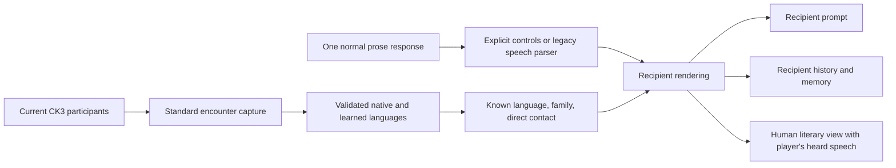

# Titan language engine

This is the internal home for Titan's spoken-language engine and its routing
plumbing. Application callers import from `../language` (`index.ts`). There is
no separate Languages page. **System → Roleplay Languages** controls new speech.

## Engine and assets

`languageEngine.ts` composes the existing encoders and router behind one
`LanguageEngine`. It accepts explicit data for isolated use; `loadLanguageEngine`
loads the shipped files from `public/languages`. `defaultLanguageEngine` provides
the main process's lazy, shared instance. Construction validates that both voice
banks cover the routing inventory and resolves every FAR profile before use.

```ts
import { defaultLanguageEngine } from '../language';

const engine = defaultLanguageEngine();
const utterance = engine.record(text, speakerKnowledge, targetKnowledge);
const heard = engine.forListener(utterance, listenerKnowledge);
// Only heard.content belongs in this listener's prompt or saved history.
```

The engine's `route` method also exposes the selected mode, reason and anchor for
local inspection. Do not put this technical explanation into character dialogue.

| Responsibility | Home |
| --- | --- |
| Module entry and composition | `index.ts`, `languageEngine.ts` |
| Authored sound data | `public/languages/close-profiles.json`, `far-profiles.json` |
| Comprehension families and direct cultural contacts | `public/languages/routing.json`, `languageRelations.ts` |
| Known/native language and spoken-language selection | `languageRouting.ts` |
| CLEAR/CLOSE/FAR recipient rendering | `languageRendering.ts`, `closeEncoder.ts`, `farEncoder.ts` |
| Shared quoting, tokenization and player markup | `src/shared/language/` |
| Explicit action/speech/thought boundaries and cleaned prose | `src/shared/language/controlledProse.ts` |
| Controlled writer convention, stock examples and narrow local repair | `controlledWriter.ts` |
| CK3 participant census and current cultural predicates | `languageCapture.ts` |
| Runtime capture, freshness, switch and campaign reset | `languageRuntime.ts` |
| Frozen recipient views and source edits | `languageConversation.ts` |
| Prompt-facing projection and writer instruction | `conversationView.ts` |
| Complete canonical ledger and archive indexes | `conversationLedger.ts`, `languageHistory.ts`, `ledgerStorage.ts` |
| Full provider summaries and idle preparation | `perspectiveSummaries.ts` |

## Routing and delivery



The existing background encounter bridge invokes the language capture body; it
does not install an extra CK3 or GoA addon. Native language comes from the
observed current cultural pillar and learned languages from `knows_language`.
Current culture/parent predicates provide the authored contact grants. Static
starter ancestry tables, race names and FAR sound roots never confer knowledge.
Capture is limited to current participants and requires complete matching frames.

Select and pin the utterance's spoken language once. Exact knowledge gives CLEAR;
a known related tongue or direct current cultural contact gives CLOSE; otherwise
use FAR. All recipients hear the same utterance through their own mode. Only
spoken ranges change: narration, gestures, punctuation and paragraph flow remain
in place. Legacy player markup and unlabelled historical turns retain the existing
speech parsers. New language-routed AI replies use `**observable narration**`,
`""audible speech""` and `~~private narration~~` throughout. The local decoder
produces ordinary italic narration and quoted speech within the original natural
paragraphs. Explicit player turns using doubled speech or thought controls must
satisfy the whole control grammar. Plain legacy player input remains supported.
No parsing-model pass or JSON prose format is introduced. A malformed, empty or
reported token-limited AI reply can use one bounded fresh generation with the full
reserved prompt; incomplete fragments are not published. Controlled replies are
currently buffered, including CLEAR speech. Off-path ordinary streaming remains.

Project before prompt construction, action inference, suggestions, diaries,
summaries and memory compaction. Only the canonical backend archive stores source
text; prompt, overlay and history-viewer reads strip all source and variant
metadata. Character knowledge excludes another actor's private spans. The human
literary view keeps the full interior prose alongside the player's frozen spoken
comprehension. Never reuse that literary view as player-character knowledge.
The generic `LanguageEngine.forListener` API defaults to a public view; owner
thought access belongs to the conversation's explicit consumer policy. Written
letters retain their existing semantics.

Knowledge projections retain delivered owner-private offsets. Prompt and memory
formatters label those ranges as unspoken inner narration before model input,
updating audible offsets without changing stored prose or the human reading.
They reject private ranges attributed to a different owner. This preserves the
distinction between remembering a thought and remembering words said aloud.
The English writer also has a narrow recovery trigger for long speech composed
entirely of foreign-looking syllables with no common English anchors. Short
utterances, proper-name lists and ordinary commands remain valid. This is not a
general language detector or a guarantee that every source word is English.

`privateMemory.ts` retains exact owned inner passages when a semantic summary
omits them. The additive encrypted-memory field binds each excerpt to its source
turn and recipient. Both compaction phases, restored memory prompts and existing
embedding input preserve it; source retractions remove it with the derived memory.
Rolling summaries read the omitted earlier private context from the canonical
ledger, and closing summaries retain it locally after provider completion. This
adds no model call or database schema and leaves the human prose unchanged.

## One ledger, explicit perspectives

`ConversationLedger` retains the complete encounter independently of the trimmed
`Conversation.messages` prompt context. A turn records its audience and each
listener's hearing mode at delivery. `LanguageConversation` stores at most three
shared CLEAR/CLOSE/FAR variants for an ordinary turn, plus sparse perception edits.
Controlled turns add private visibility to shared variant identity; their exact
speech/prose offsets belong to each variant. The encountered player's literary
reading has a separate reference, without another transcript branch. The variant
hash binds source revision, tongue, locale, private policy when applicable, and the
complete encoder fingerprint. A speaker hears their own words clearly. Learning later never rewrites
old hearing; arrivals miss earlier events, departures retain their own earlier view.

`read(characterId, rangeIds, revision, purpose = 'knowledge')` uses no global
current-perspective state. Only the encountered player may request `reader`.
Projected copies contain only that owner's text and public event metadata.
Source edits preserve historical modes; perception edits affect only their owner.
Controlled edits round-trip explicit boundaries. The native editor exposes only
already-heard words with their controls and displays cleaned prose on save; foreign
edits preserve the source and other listeners. The renderer preserves original
line breaks rather than separating actions and speech into artificial paragraphs.
Edits/undo/regeneration invalidate rolling summaries and encounter-derived compacted
memories/vectors. Pending compaction, embedding and summary results check revisions.

Atomic private checkpoints and the closing archive use version 2 under
`conversation_history/<player>/.language-ledgers/`. Compatibility player TXT exports
and campaign `.recipient-views` indexes refer to the same canonical file. The reader
validates the complete hearing record and index digest; an incomplete new archive
never falls back to plain source text. The version 1 reader remains an explicit
compatibility adapter; new archives contain no full per-recipient transcript forks.
Campaign/timeline visibility still gates history before projection. This does not
replace Agency's separate transcript schema.

Rolling summaries use the existing configured provider, prompts and response
budgets separately for each distinct actual request. Identical requests can reuse
full results; no local substitute abbreviates another listener's summary. Idle
preparation near the context limit uses the existing provider lane and yields to
foreground requests. End summaries and diaries see the whole encounter. Oversized
summary input uses bounded owner-specific passes; an oversized single turn holds.
Compaction keeps the existing algorithms, separates owners in both phases, retains
source IDs for retractions, and holds on failed owned persistence. Its failure can
fall back to the ordinary full summarizer. Existing embedding transport/dimensions
stay intact; encounter-derived vectors keep retractable IDs instead of automatic
consolidation. Knowledge and summary/diary editors remain author tools.

AI-to-AI language continuations retain the actor's observed working context;
previously that path always requested an empty history. Disabled routing keeps the
installed parent convention. All custom persona, lore, faith/culture, Zealous,
scene and action formulas remain outside the language engine.

## Master checkbox

`Config.languageRoutingEnabled` persists the **Roleplay Languages** checkbox in
the existing config file. It defaults to true for legacy settings, preserving
the development candidate's behavior. The existing config-change IPC updates it
live through `setLanguageRoutingEnabled`; switching off removes the active
language capture catalog and invalidates owned observations without refreshing
or regenerating culture/faith profiles.

While off, new speech passes through unchanged, the language writer instruction
is omitted, and normal streaming is available. These messages carry the local
`languageRoutingBypassed` marker so re-enabling does not reinterpret them.
Previously recorded heard views remain frozen. Turning on reuses the same sound
assets and FAR seed, and requires fresh participant knowledge before the next
language-enabled generation. A generated reply reserves its audience and hearing before streaming. A response
already being generated keeps that policy when the switch changes; new replies
use the new setting. No extra parsing model or prose regeneration is needed.

## Adding or revising voices

Keep comprehension rules separate from sound profiles. Every routed language
needs a CLOSE and FAR bank, including singleton families. The current 53 banks
include 24 CLOSE voices without a default eligible relationship; writing a voice
does not itself create a contact grant. Cultural links are direct and directional,
never recursively inferred from another grant.

Preserve the FAR version, vocabulary seed (`titan-demo`), normalization table,
root namespace and sound data unless deliberately authoring a sound revision.
A seed or version change can replace vocabulary for every word. This module
integration changes none of those assets or the shared speech parser.

`tests/language` contains independent encoder references, capture/routing checks,
actual production prompt/history checks and on/off/on regressions. Build generated
JavaScript with TypeScript after edits. The prior voice research and finite Mimir
evidence live in `docs/language-close-implementation.json` and
`docs/language-close-authoring.json`. Development checks do not establish fresh
CK3 execution of the language capture predicates. This module has not been
deployed to the installed companion.

## CLOSE 3.0 voices

The readable banks use at most one preferred cadence within the existing original-token rewrite budget. `voice-revisions.json` ships the exact 2.4 parent for source edits to historical hearings; stored perceptions and Learning plans remain frozen. FAR, routing and Learning curves are unchanged. See `docs/language-close-texture-3.0.txt` for finite evidence and limits.
